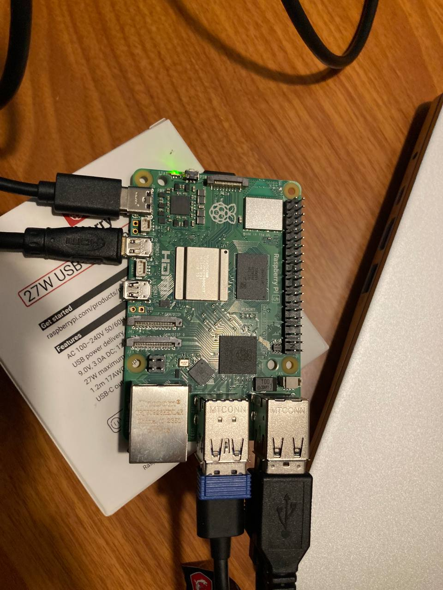
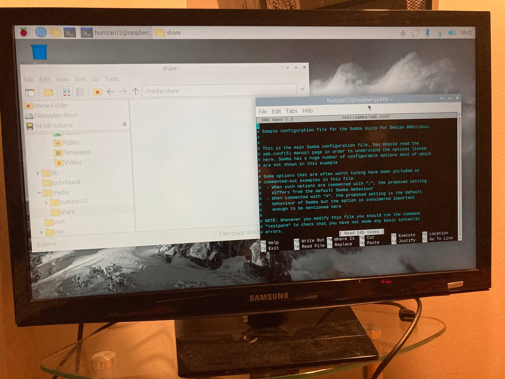
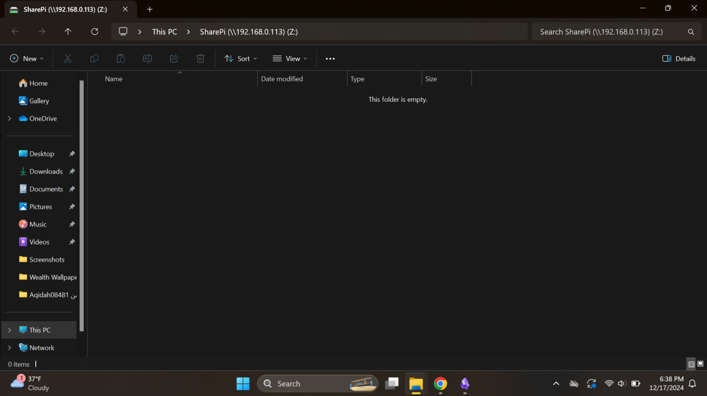

# Raspberry Pi 5 Samba File Server

A home network-attached storage (NAS) build: turning a Raspberry Pi 5 into a shared file server using **Samba (SMB/CIFS)**, then mounting it as a network drive from a Windows 11 laptop. A small, practical project in Linux administration, network file sharing, and the SMB protocol.


*The Raspberry Pi 5 running the server, powered over USB-C with Ethernet and storage attached.*

---

## Overview

| | |
|---|---|
| **Hardware** | Raspberry Pi 5 (powered via 27W USB-C), USB storage |
| **OS** | Raspberry Pi OS (Debian-based) |
| **Share protocol** | Samba (SMB/CIFS) |
| **Server hostname / IP** | `raspberrypiHN` · `192.168.0.113` |
| **Share name** | `SharePi` → `/media/share` |
| **Client** | Windows 11 laptop (mapped network drive) |

---

## 1. Install and enable the services

Two services are needed: **SSH** for remote administration of the Pi, and **Samba** to serve the share over the network.

```bash
# Start the SSH service for remote management
sudo service ssh start

# Install the Samba file-sharing suite
sudo apt-get install samba
```

> **Tip for a permanent setup:** `sudo service ssh start` enables SSH for the current session. To have it start automatically on every boot, use `sudo systemctl enable ssh` (or enable it under `sudo raspi-config` → Interface Options).

## 2. Configure the shared folder

Give the folder that will be shared full read/write/execute permissions, then define the share in Samba's config file.

```bash
# Permissions on the folder to be shared
sudo chmod 777 /media/share

# Edit the Samba configuration
sudo nano /etc/samba/smb.conf
```


*Editing `/etc/samba/smb.conf` on the Pi, with the `/media/share` folder open in the file manager.*

Add the following share definition to the bottom of `smb.conf`:

```ini
[SharePi]
   comment = RaspberryPi
   public = yes
   writeable = yes
   browsable = yes
   path = /media/share
   create mask = 0777
   directory mask = 0777
```

**What each directive does:**

| Directive | Purpose |
|---|---|
| `[SharePi]` | The share name clients will see on the network |
| `comment` | A friendly label for the share |
| `public = yes` | Allow guest access without a username/password |
| `writeable = yes` | Permit clients to create and modify files |
| `browsable = yes` | Show the share when browsing the network |
| `path` | The folder on the Pi being shared |
| `create mask` / `directory mask` | Default permissions applied to new files and folders |

Save and exit (**Ctrl+O**, **Enter**, **Ctrl+X**).

> **Good habit:** after editing, run `testparm` to check the config for syntax errors before relying on it, and `sudo systemctl restart smbd` to apply the changes.

## 3. Mount the share from Windows 11

On the Windows laptop, the share is mapped as a network drive:

1. Open **File Explorer**, right-click **This PC**, and choose **Map network drive**.
2. Pick a drive letter (e.g. `Z:`).
3. In **Folder**, enter the Pi's IP address and share name in UNC format:
   ```
   \\192.168.0.113\SharePi
   ```
4. Click **Finish**.


*`SharePi` mounted as drive `Z:` on Windows 11 — files dropped here are stored on the Pi and visible to any device on the network.*

The share now appears as a normal drive in Explorer. Anything copied into `Z:` lives on the Pi's storage and is accessible from any device on the LAN.

---

## Security considerations

This build uses **open guest access** (`public = yes`, no authentication) and world-writable permissions (`chmod 777`), which is fine for a trusted home LAN and a learning project, but would **not** be appropriate on an untrusted or shared network. If I were hardening this for real use, I would:

- **Require authentication** — remove `public = yes`, create a Samba user with `sudo smbpasswd -a <user>`, and set `valid users` on the share.
- **Tighten permissions** — replace `777` with the least privilege that works (e.g. `770` with a dedicated group), instead of world-writable.
- **Restrict access by host** — use `hosts allow` in `smb.conf` to limit which subnets can reach the share.
- **Disable SMBv1** and enforce SMB signing to resist downgrade and tampering.
- **Keep SSH key-based** — disable password login for SSH and use keys.

Calling this out is deliberate: knowing *why* a convenient default is risky is as important as getting the share working.

---

## What I learned

- Installing and configuring **Samba** to expose a Linux directory over SMB/CIFS.
- How Linux file permissions (`chmod`) interact with Samba's own `create mask` / `directory mask`.
- Mapping a network drive from Windows using **UNC paths** (`\\IP\share`).
- The trade-off between convenience (guest access) and security (authenticated, least-privilege shares).

## Future work

- Add authenticated users and per-user home shares.
- Mount a dedicated external SSD/HDD and auto-mount it via `/etc/fstab`.
- Set a static IP (or DHCP reservation) so the server address never changes.
- Schedule automated backups of the share.

---

*A home-lab project built on hardware I own, on my own local network.*
